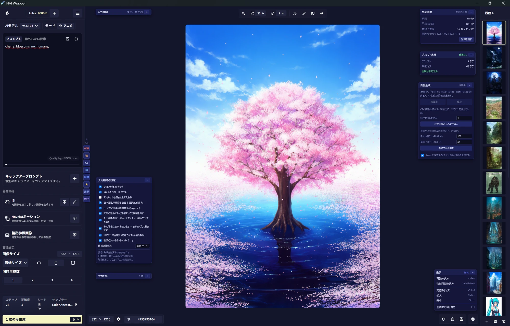
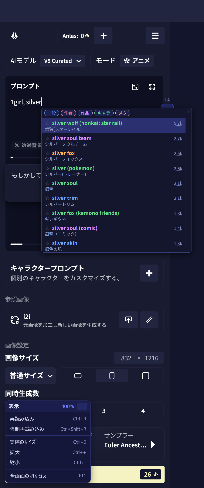
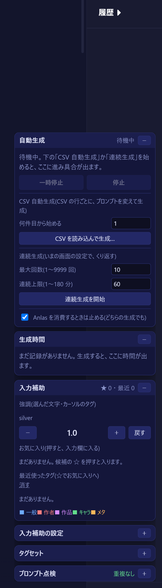

# NAI Wrapper (非公式・ベータ版)

novelai.net を専用ウィンドウで開く Electron ラッパーです。Windows / macOS / Linux 対応。

## 注意(必ずお読みください)
- **非公式のアプリです。** NovelAI(Anlatan Inc.)とは、提携も承認も推薦も受けていません。
- **自己責任でお使いください。** NovelAI の利用規約に従ってください。特に「CSV 自動生成」「連続生成」は、規約の、許可されていない方法でのアクセスや、サービスの制限を無視する自動化システムの禁止に当たると、判断されるおそれがあります。アカウントへの制限・停止など、このアプリの利用で生じた問題について、作者は責任を負いません。使うときは、回数や連続の上限を控えめにしてください。
- **ベータ版です。** NovelAI の画面の作りが変わると、自動生成などが動かなくなることがあります。
- **動作確認の状況**(下の表)を、ダウンロードの前に見てください。

| OS | 状況 |
|---|---|
| Windows | 開発環境(`npm start`)で確認済み。インストーラ版・ポータブル版は、未確認 |
| macOS | **試験版・動作未確認**(Apple Silicon の arm64 向け。Intel Mac では動かない可能性があります) |
| Linux | **試験版・動作未確認**(AppImage・deb) |

## スクリーンショット
NovelAI の画面の上に、このアプリのパネルやチップが重なって表示されます(画面そのものは NovelAI のもので、このアプリのものではありません)。

- **タグの入力補助**: タグの途中まで打つと、辞書から候補を出します(日本語訳つき。種類ごとの色分け・お気に入り・絞り込みつき)。

  

- **パネル**: 自動生成(CSV・連続生成。一時停止・停止)、生成時間、入力補助、タグセット、プロンプト点検など。

  

## ダウンロード
[Releases](../../releases) から、お使いの OS 向けのファイルをダウンロードしてください(いまは **0.1.0・ベータ版・pre-release** です)。

| OS | ファイル | 状況 |
|---|---|---|
| Windows | `NAI.Wrapper.Setup.0.1.0.exe`(インストーラ版) | 未確認 |
| Windows | `NAI.Wrapper.0.1.0.exe`(ポータブル版。インストール不要) | 起動・ログインの保持を確認済み |
| macOS | `NAI.Wrapper-0.1.0-arm64.dmg` / `NAI.Wrapper-0.1.0-arm64-mac.zip`(Apple Silicon 向け) | **試験版・動作未確認** |
| Linux | `NAI.Wrapper-0.1.0.AppImage` / `nai-wrapper_0.1.0_amd64.deb` | **試験版・動作未確認** |

- ダウンロードしたファイルは、署名がないため、初めて起動するときに警告が出ます(次の「署名なしの警告」を見てください)。
- 辞書・日本語訳・拡張機能は付属していません(辞書は、メニュー「入力補助 → 辞書を作る(Danbooru から取得)…」で作れます)。
- 使い方は、アプリのメニュー「ヘルプ → マニュアルを開く」と、この README の下のほうにあります。

## 署名なしの警告
このアプリには、**コード署名をしていません**(個人開発で、署名の費用と手間をかけないためです)。初めて起動するとき、OS が警告を出します。ダウンロード元(このリポジトリの Releases)を確かめたうえで、自分で判断して、次の方法で開いてください。
- **Windows(SmartScreen)**: 「Windows によって PC が保護されました」と出たら、「**詳細情報**」を押して、「**実行**」を押します。
- **macOS(Gatekeeper)**: アプリを**右クリック**して「**開く**」を選び、出てきた画面でもう一度「開く」を押します。それでも開けないときは、「システム設定 → プライバシーとセキュリティ」の下のほうに出る「このまま開く」を押します。
- **Linux(AppImage)**: ファイルを実行できるようにします(`chmod +x NAI.Wrapper-*.AppImage`)。

## 起動
    npm install
    npm start

## インストーラ作成(実行した OS 向け)
    npm run dist

`dist/` に出力されます。3 OS 分は GitHub Actions でビルドします。
- `.github/workflows/build.yml`(確認用): main への push と PR で自動実行します。手動実行では OS を選べます。1 形式だけ(Windows=ポータブル版、macOS=zip、Linux=AppImage)で、成果物は 14 日で消えます。
- `.github/workflows/release.yml`(リリース用): `v*` タグを push すると、3 OS の全形式をビルドして、GitHub の Releases に**下書き・pre-release**で載せます(公開は、人が下書きを解除して行います)。タグと `package.json` の `version` が違うと、失敗します。

## 拡張機能(パッケージ化されていないもの)
展開済みの Chrome 拡張機能(`manifest.json` があるフォルダ)を、起動時に読み込めます。
1. メニューの「Extensions → 拡張機能フォルダを開く」でフォルダを開く。
2. 拡張機能のフォルダ(例: `my-extension/`)をそのまま中に置く。
3. アプリを再起動する。

4. 設定画面がある拡張機能は、メニューの「Extensions → 設定を開く: (拡張機能の名前)」で開けます(拡張機能自身のボタンでは開けないため)。

- 拡張機能は**このアプリに付属していません**。各自で入手し、それぞれのライセンスに従ってください。
- `.crx` や Chrome ウェブストアからのインストールには対応していません。
- Electron が対応している拡張機能の API は一部だけです。使えない API(`chrome.downloads`・`chrome.notifications`・`chrome.tabs.create` など)を使う拡張機能は、その部分(または全体)が動きません。動かない拡張機能もあります。
- 拡張機能は novelai.net のページ内で動き、ログイン情報にアクセスできます。信頼できるものだけを入れてください。

## 窓まわり
- 「表示」ツールチップ: 画面の左下に、メニュー「View」と同じ操作(再読み込み・強制再読み込み・実際のサイズ・拡大・縮小・全画面)のボタンと、いまの拡大率(例: `120%`)を出します。ヘッダーをドラッグして動かせ(位置は覚えています)、ヘッダーのボタンで最小化できます。メニュー「View」で、表示を切り替えられます。
- メニューは、ふだんは隠れています。`Alt` キーだけを押して離すと、画面の手前にポップアップで開きます(メニューバーを出さないので、窓の中身は動きません)。
- 窓の位置・大きさ・最大化・拡大率は、次に開くときも覚えています。
- メニュー「View」に「常に最前面に表示」と「パネルの位置を右下に戻す」があります。
- メニュー「View → 配色」で、タイトルバー・メニュー・ダイアログの配色を、ダーク(初めの設定)・ライト・システムに合わせる、から選べます。NovelAI の画面の中身は変わりません。

## 連続生成
CSV を使わず、いまの画面の設定(プロンプト・サイズ・モデルなど)のまま、「生成」を繰り返します。「自動生成」パネルの「連続生成」で、**最大回数**(1〜9999 回)と**連続上限**(1〜180 分)を入れて、「連続生成を開始」を押します(メニュー「自動生成 → 連続生成を開始」でも始められます)。
- どちらかに先に達したら、止まります(時間の上限は、生成中の 1 枚が終わってから止まります)。
- Anlas を消費する表示になったとき、画面にエラーが表示されたときも、止まります(メニュー「自動生成」のチェックがオンのとき。既定はオン)。
- 終わったとき・止まったときは、デスクトップ通知を出します(メニュー「自動生成 → 終わったとき、窓が裏にあれば通知する」がオンのとき)。
- 止めるときは、パネルの「停止」(進み具合のすぐ下にあり、CSV 自動生成にも効きます)か、メニューの「自動生成 → 停止」です。
- 休むときは、パネルの「一時停止」(「停止」の左隣。CSV 自動生成にも効きます)か、メニューの「自動生成 → 一時停止」です。生成中の 1 枚が終わってから、次の回に進む前で止まります。もう一度押す(「再開」)と、続きから始めます。止まっている間は、経過時間も連続上限の時間も進みません。
- 「自動生成」パネルは、上から、進み具合、「一時停止」と「停止」、「CSV 自動生成」(CSV の行ごとに、プロンプトを変えて生成)、「連続生成」(いまの画面の設定で、くり返す)の順に並びます。
- パネルに、進み具合(回数・経過時間と上限・終わるまでの目安)を出します。

## CSV 自動生成
CSV に書いたプロンプトを、1 行ずつ順番に生成します。
1. メニューの「自動生成 → CSV を読み込んで生成…」を選び、CSV を選ぶ。
2. 件数を確認して「開始」。止めるときは「自動生成 → 停止」(実行中の 1 枚が終わってから止まります)。

画面の右下に、次のパネルが出ます。パネルは、それぞれ別々に動かせます(ヘッダーの「－」で最小化、ヘッダーをドラッグすると、そのパネルだけが離れて好きな位置に置けます。位置は覚えています。メニュー「View → パネルを右下にまとめ直す」で、右下に戻せます)。メニュー「View」で、パネルごとに表示を切り替えられます。自動生成が終わったとき、アプリが別の窓の後ろにあれば、タスクバーで点滅して知らせます。
- 「自動生成」パネル: 進み具合(件数・進捗バー・経過時間・残りの目安)の表示と、CSV の読み込み・停止・「Anlas を消費するときは止める」の操作。最小化しても、件数と進捗バーは見えます。
- 「生成時間」パネル: 生成にかかった時間(前回・平均・最短/最長・直近 5 回)。自動生成でも、手動の生成でも計測します。
- 「入力補助」パネル: 強調(選んだ文字・カーソルのタグの重みを「－」「＋」で上げ下げ)、お気に入りと最近使ったタグ(押すと入力欄に入ります)。
- 「タグセット」パネル: よく使うタグの組み合わせに名前を付けて保存し、押すと入力欄のカーソルの位置にまとめて入れます(入力欄で文字を選び、「選んだ文字を取り込む」→ 名前 →「保存」)。
- 「プロンプト点検」パネル: 入力欄ごとのタグの数と、重複しているタグ、プロンプトとネガティブの両方にあるタグを知らせます。キャラクタープロンプトも数えます(「キャラクタープロンプト1」「キャラクタープロンプト2」…。閉じているカードは、プレビューの文字から数えるので、省略されているときは「約」と出ます。キャラクターごとのネガティブ(除外)は、カードを開いているときしか画面に出ないため、開いていたときの数を「前回」として出し、一度も開いていないカードは「開くと数えます」と出ます)。パネルのタイトルの横には、重複しているタグの数を出します(「重複 3」。プロンプトとネガティブの両方にあるタグがあれば「両方 1」も)。入力欄の中でも、重複しているタグは黄色、プロンプトとネガティブの両方にあるタグは水色で示します(NovelAI の強調の赤背景と区別するため。「入力補助の設定」パネルでオフにできます)。最小化しても、ヘッダーに数が出ます。
- 「入力補助の設定」パネル: タグのサジェスト・日本語検索・migemo・強調のショートカット・候補の最大数などの切り替え(初めは最小化されています)。
- 途中から再開するとき: 「自動生成」パネルの「何件目から始める」に番号を入れてから、CSV を読み込みます(開始するたびに 1 に戻ります)。
- 画面にエラー(通知)が表示されたら、そこで止まります(メニュー「自動生成 → 画面にエラーが表示されたら止める」。既定はオン)。
- 終わったとき、アプリが裏にあれば、通知とタスクバーの点滅(macOS は Dock が跳ねる)で知らせます。

CSV の形式(UTF-8、1 行目は見出し。`examples/prompts.csv` も参照):

    prompt,negative,character1,character2
    "1girl, smile, sunset",lowres,"girl, red hair",
    "1boy, forest",,"boy, black hair","girl, blonde"

- 使える列: `prompt`(プロンプト)、`negative`(ネガティブプロンプト)、`character1`・`character2`…(キャラクタープロンプト)。どれも省略できます。
- **空欄のセルは、画面に今入力されている内容をそのまま使います**(書き換えません)。
- キャラクターは、`character1`・`character2`… の順に、画面のキャラクターの並び順に対応します。足りないときは、見出し横の追加ボタンを押して増やします。追加時の「女性 / 男性 / その他」は、プロンプトの書き出しで選びます(`girl` / `woman` / `female` → 女性、`boy` / `man` / `male` → 男性、それ以外 → その他)。減らしはしません(不要なキャラクターは手動で消してください)。
- **キャラクターの列の右隣に、見出しが空の列があれば、同じキャラクターのタグとして足します**(値は「, 」でつなぎます)。見出しより右に長い行も同様です。たとえば `character1,,` の見出しなら、1〜3 列目が 1 人目のタグになります。
- **`character1+` のように末尾に `+` を付けた列**は、置き換えではなく、**今の画面のキャラクター欄の内容を固定部分として、その後ろにタグを足します**(`固定部分, タグ` の形)。開始時の内容を覚えておき、終わったら(途中で止めたときも)固定部分だけに戻します。空欄の行は、固定部分だけになります。同じキャラクターの `character1` と `character1+` は、どちらか一方だけ書けます。
- **キャラクター列の空欄は「そのキャラクターは使わない」** という意味で、画面のそのキャラクターの**プロンプトと UC(除外したい要素)を、どちらも空にします**(カードは削除しません。UC は元に戻しません)。画面にそのキャラクターがなければ何もしません。増やしもしません。キャラクター列自体を書かなければ、画面のキャラクターには触りません。
- キャラクターごとのネガティブ(UC)や位置の指定には対応していません。
- 画像サイズ・モデルなどの設定は、現在の画面のものがそのまま使われます。
- 画面を操作して入力・ボタン押下を行うため、novelai.net の画面が変わると動かなくなる可能性があります。
- 生成ボタンに Anlas の消費が表示されたら、そこで止めます(メニューの「Anlas を消費するときは止める」で切り替え。既定はオン)。
- うまく動かないときは、メニューの「自動生成 → 画面の構造を調べる(調査用)」で、画面の入力欄・ボタン・キャラクター欄の構造を表示・コピーできます(入力した文字は含みません)。

## 画像の保存方法
保存できたときは、画面の下の真ん中に「○○.png を △△ に保存しました」と、数秒出ます(押すと、保存したフォルダを開きます。メニュー「保存 → 保存したとき、画面にお知らせを出す」で、オフにできます)。

メニューの「保存」で、ダウンロード(画像の保存など)の扱いを選べます。設定はアプリを閉じても残ります。
- **毎回、保存先を選ぶ**(既定): 保存のたびに「名前を付けて保存」が出ます。
- **決めたフォルダに自動で保存する**: 「保存先フォルダを選ぶ…」で決めたフォルダに、確認なしで保存します。同じ名前のファイルがあるときは、`名前 (1).png` のように別名にして、上書きしません。
- 自動保存をオンにしたとき、保存先が未設定なら、先にフォルダを選びます(選ばなければオンになりません)。保存先のフォルダが見つからなくなったときは、毎回選ぶ動きになります。
- 保存できなかったときは、エラーを表示します。

### ファイル名のルール
メニューの「保存 → ファイル名のルールを設定…」で、保存するファイル名の書式を決められます(拡張子は元のものが付きます)。既定は `{元の名前}`(元の名前のまま)です。
- 書式の中の部品: `{日時}`(例: 20261112_153045)、`{日付}`、`{時刻}`(書式を変えるときは `{日時:YYYY-MM-DD_HHmmss}` のように「:」のあとに書きます。YYYY 年 / YY 年(下 2 桁) / MM 月 / DD 日 / HH 時 / mm 分 / ss 秒)、`{連番}`(001, 002…。保存のたびに増えて、アプリを閉じても続きます。メニューの「連番を 1 に戻す」で戻せます)、`{元の名前}`、`{行}`・`{キャラ1}`・`{キャラ2}`…(自動生成中の保存のときだけ、CSV の行番号とキャラクターのタグが入ります。それ以外のときは空です)。
- 例: `{日付}_{連番}`、`{日時}_{キャラ1}`。設定画面で、保存名の例を確認できます。
- ファイル名に使えない文字(`\ / : * ? " < > |`)は `_` になります。
- 「毎回、保存先を選ぶ」のときも、「名前を付けて保存」の最初の名前に使われます。

## マニュアル
メニューの「ヘルプ → マニュアルを開く」で、使い方(CSV の書き方、保存方法、ファイル名のルール、拡張機能、困ったとき)を読めます。

## ライセンス
NAI Wrapper は MIT ライセンスです(`LICENSE`)。メニューの「ヘルプ → ライセンスと権利表記を開く」で、非公式であることの説明、MIT ライセンス、使っている部品(Electron・jsmigemo・migemo 辞書)の権利表記を読めます(`licenses.html`)。

### 入力補助(タグのサジェスト)と辞書(任意)
プロンプト欄にタグを入力すると、取り込んだ辞書から候補を出します(`↑` `↓` で選び、`Enter` か `Tab` で入れます)。別名での検索、日本語名での検索(日本語訳を取り込んだとき)、ローマ字での日本語検索(migemo)に対応しています。保存名の `{tag}`・`{characters}`(キャラクターのタグ)にも、この辞書を使います。

- 文字の途中にカーソルを置いたとき: すでに書いてあるタグの中をクリックしたり、矢印キーでカーソルを動かしたりすると、そのタグ全体の候補が出ます(選ぶと、そのタグが置き換わります)。カーソルを動かして出た候補では、`↑` `↓` `Enter` は入力欄で使えます(選ぶのは、クリックか `Tab`、`Esc` で閉じる)。文字を打って出た候補は、今までどおり `↑` `↓` で選べます。「入力補助の設定」パネルでオフにできます。
- 分類の絞り込み: 候補リストの上に、分類ごとのボタン(一般・作者・作品・キャラ・メタ)が出ます。押すと ON / OFF が切り替わり、OFF にした分類は候補に出ません(覚えています)。お気に入りと最近使ったタグの文字も、同じ分類の色で表示します。
- お気に入り: 候補の左の「☆」を押す(または `Ctrl+D`)と「★」になり、その候補が上に出ます。確定したタグは「最近使ったタグ」として覚え、これも少し上に出ます。何も打っていないときに `Ctrl+Space` を押すと、お気に入りと最近使ったタグの一覧が出ます。「入力補助」パネルのチップを押しても入力欄に入り、「消す」で消せます。
- 入力欄のそばのチップ: カーソルのある入力欄の右がわに、30px のチップが縦に並びます(上から「超強」「強」「1.0」「弱」「超弱」「★」「履歴」「セット」)。押しても、入力欄のカーソル・選択は動きません。入力欄にカーソル(フォーカス)がないときは、何も入れず、「挿入する場所(入力欄)に、カーソルを置いてから押してください」と、チップの横に出します(常に表示のときも同じです)。「強」「弱」は、いまフォーカスしているタグ(選んでいれば、選んだ文字)の重みを 0.1、「超強」「超弱」は 1.0 ずつ上げ下げします(-9.9〜+9.9)。「★」「履歴」は、押すとお気に入り・最近使ったタグの一覧が開き、行を押すと、カーソルの位置(選んでいれば、その上)に入ります。各チップには、ショートカットキーもあります(マウスを載せると、説明に出ます): 強 `Ctrl+↑` / 弱 `Ctrl+↓` / 超強 `Ctrl+Shift+↑` / 超弱 `Ctrl+Shift+↓` / ★ `Ctrl+Shift+F` / 履歴 `Ctrl+Shift+H` / セット `Ctrl+Shift+S`(macOS は `Cmd`。一覧のキーは、もう一度押すと閉じます)。「セット」は、「タグセット」パネルで保存したセットの一覧を開き、行を押すと、セットのタグがまとめて入ります。「入力補助の設定」パネルでオフにできるほか、「チップを常に表示する」をオンにすると、入力欄のフォーカスに関係なく出し続け、つまみ(≡)をドラッグして好きな位置に動かせます(位置は覚えています。メニュー「View → パネルを右下にまとめ直す」で、初めの位置に戻ります)。
- 強調の補助(辞書がなくても使えます): 文字を選ぶか、タグの中にカーソルを置いて `Ctrl+↑` / `Ctrl+↓` を押すと、`1.1::タグ::` のように重みを 0.1 ずつ上げ下げします(1.0 に戻ると記号が外れます。範囲は -9.9〜+9.9)。「入力補助」パネルの「－」「＋」でも同じことができます。ショートカットは、「入力補助の設定」パネルでオフにできます。

辞書と日本語訳は、このアプリに**付属していません**。いちばん簡単なのは、メニュー「入力補助 → 辞書を作る(Danbooru から取得)…」です。Danbooru の公開 API に接続して、辞書と日本語訳を作ります(約 10 分・約 30MB。途中で止められ、作り終えるまで、いまの辞書は変わりません)。自分でファイルを取り込む方法(メニュー「入力補助 → 辞書を取り込む…」)は、マニュアルの「辞書と日本語訳の入手と取り込み」に書いてあります。入手先の例として、tagdb-updater(GitHub。ログイン不要)と、Civitai の「Danbooru tag complete csv」(ログインが必要)を載せています。

## 補足
- ログイン状態は `persist:novelai` セッションに保存されます。
- novelai.net 以外のリンクは既定ブラウザで開きます。
- 未署名のため、macOS は「右クリック→開く」、Windows は SmartScreen の警告が出ます。
- 非公式アプリです。NovelAI の利用規約に従ってご利用ください。
